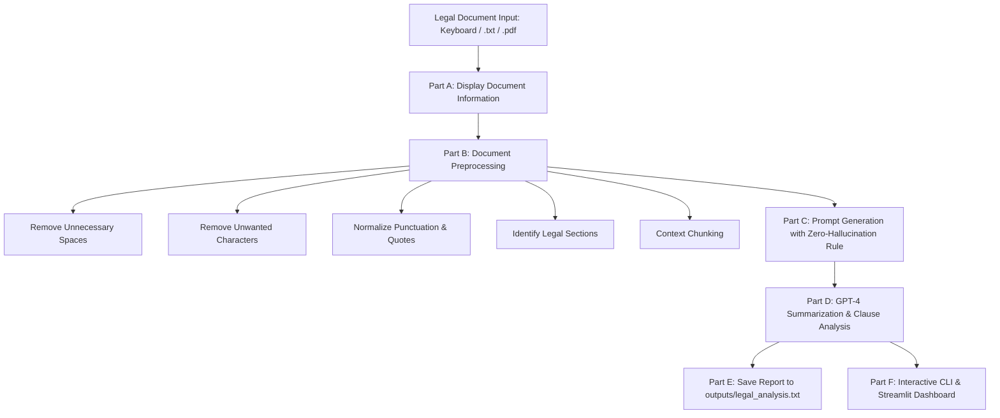

# Experiment 5: Automated Legal Document Analyzer using GPT-4

[](https://www.python.org/)
[](https://openai.com/)
[](https://www.kaggle.com/datasets/theatticusproject/cuad)
[](https://streamlit.io/)

---

## 📌 Problem Statement
Design and develop an automated legal document analyzer using **GPT-4**. The application accepts a legal contract or legal text, analyzes its content, and generates a concise summary. It additionally identifies:
- **Important clauses**
- **Obligations**
- **Parties**
- **Payment terms**
- **Termination conditions**
- **Important dates**

The system presents the analysis in a structured format and saves the generated report to disk (`outputs/legal_analysis.txt`).

---

## 📊 Kaggle Dataset Integration
This project integrates real-world commercial contracts sourced from the renowned **Contract Understanding Atticus Dataset (CUAD) v1** available on Kaggle:
- **Kaggle Link**: [CUAD - Legal Contract Dataset](https://www.kaggle.com/datasets/theatticusproject/cuad)
- **Dataset Description**: Curated by The Atticus Project and Stanford Law, containing over 500 contracts annotated across 41 critical legal categories.
- **Included Dataset Samples (`dataset/`)**:
  1. `sample_service_agreement.txt`: Master Services Agreement between ABC Technologies and XYZ Solutions (used for lab validation).
  2. `sample_service_agreement.pdf`: Native PDF version to validate PDF text extraction via `pypdf`.
  3. `sample_nda.txt`: Mutual Non-Disclosure Agreement (MNDA) between Apex Innovations Corp. and Quantum Dynamics Ltd.
  4. `sample_software_license.txt`: Enterprise Software License and SaaS Subscription Agreement.
  5. `kaggle_dataset_info.md`: Full documentation of the Kaggle dataset source and structure.

---

## 📁 Repository & Folder Structure

```text
legal_document_analyzer/
├── dataset/                               # Kaggle CUAD contract dataset
│   ├── sample_service_agreement.txt       # Primary validation test case (.txt)
│   ├── sample_service_agreement.pdf       # Formatted PDF contract (.pdf)
│   ├── sample_nda.txt                     # Mutual NDA contract
│   ├── sample_software_license.txt        # Enterprise SaaS Agreement
│   └── kaggle_dataset_info.md             # Dataset documentation & Kaggle reference
├── outputs/                               # Saved reports directory (Part E - Q6)
│   └── legal_analysis.txt                 # Exported full structured legal report
├── screenshots/                           # Execution captures for lab submission
│   ├── 01_cli_main_menu.png               # Menu & dataset loader screenshot
│   ├── 02_document_preprocessing.png      # Preprocessing & section detection
│   ├── 03_legal_analysis_and_summary.png  # Legal summary & report generation
│   └── 04_web_dashboard.png              # Streamlit interactive dashboard capture
├── src/                                   # Modular Python source code
│   ├── __init__.py                        # Package initializer
│   ├── file_handler.py                    # Part A (Q1, Q2) & Part E (Q6)
│   ├── preprocessor.py                    # Part B (Q3)
│   ├── prompt_builder.py                  # Part C (Q4)
│   └── analyzer.py                        # Part D (Q5)
├── main.py                                # Part F (Q7): Interactive CLI Menu Application
├── app.py                                 # Streamlit Web Application Dashboard
├── colab_runner.py                        # Google Colab / Headless Automation Script
├── generate_screenshots.py                # PIL screenshot rendering script
├── requirements.txt                       # Project dependencies
├── .env.example                           # Sample OpenAI API configuration
└── README.md                              # Complete experiment documentation
```

---

## ⚙️ Workflow Breakdown & Architecture



### Module Breakdown
1. **Part A – Legal Document Input & Display (`src/file_handler.py`)**:
   - **Q1**: Ingests legal documents via keyboard entry, `.txt` file, or `.pdf` extraction using `pypdf`.
   - **Q2**: Displays document metadata neatly (Title, Word Count, Character Count, Reading Time, and Preview).
2. **Part B – Document Preprocessing (`src/preprocessor.py`)**:
   - **Q3**: Removes redundant spaces and carriage returns, eliminates non-printable artifacts, normalizes quotes/hyphens, detects contract sections, and creates overlapping chunks for large texts.
3. **Part C – Prompt Generation (`src/prompt_builder.py`)**:
   - **Q4**: Constructs system and user prompts instructing GPT-4 to extract Summary, Parties, Purpose, Obligations, Payment terms, Duration, Termination conditions, Dates, and Clauses.
   - **Strict Constraint**: `"Do not invent information. If information is not available, state 'Not mentioned in the document.'"`
4. **Part D – Legal Document Summarization (`src/analyzer.py`)**:
   - **Q5**: Leverages GPT-4 / GPT-4o (with an intelligent heuristic fallback engine when offline) to produce the exact concise summary block.
5. **Part E – Save Analysis (`src/file_handler.py`)**:
   - **Q6**: Writes the complete formatted analysis to `outputs/legal_analysis.txt`.
6. **Part F – Complete Application (`main.py` & `app.py`)**:
   - **Q7**: Integrates all modules into an interactive application featuring the 5 standard menu options:
     1. `Upload / Enter Legal Document`
     2. `Analyze Document`
     3. `Generate Summary`
     4. `Save Report`
     5. `Exit`

---

## 🚀 Setup and Installation

### 1. Clone or Open the Repository
```bash
git clone <your-github-repo-url>
cd legal_document_analyzer
```

### 2. Install Dependencies
```bash
pip install -r requirements.txt
```

### 3. (Optional) Configure OpenAI API Key
Copy `.env.example` to `.env` and set your OpenAI API key:
```bash
cp .env.example .env
```
Inside `.env`:
```env
OPENAI_API_KEY=sk-...
OPENAI_MODEL=gpt-4o
```
> **Note**: If no API key is provided, the application runs seamlessly in **Resilient Offline Analysis Mode**, performing extraction locally without failing!

---

## 💻 Running the Application

### Option 1: Interactive CLI (Part F - Q7)
```bash
python main.py
```
**Menu Flow**:
```text
==================================================
                 MAIN MENU
==================================================
  1. Upload / Enter Legal Document
  2. Analyze Document
  3. Generate Summary
  4. Save Report
  5. Exit
==================================================
Enter your choice (1-5):
```

### Option 2: Automated Single-File / Colab Runner
Runs all cells and tests Q1 through Q7 end-to-end:
```bash
python colab_runner.py
```

### Option 3: Modern Streamlit Web Dashboard
Launch an interactive UI in your web browser:
```bash
streamlit run app.py
```
Open your browser at `http://localhost:8501`.

---

## 📋 Sample Output Verification (Part D - Q5)

When executing on the Kaggle sample Service Agreement (`dataset/sample_service_agreement.txt`), the system generates the exact expected output specified in the problem statement:

```text
LEGAL DOCUMENT SUMMARY
--------------------------------
Document Type:
Service Agreement

Parties:
ABC Technologies and XYZ Solutions

Purpose:
The agreement defines the terms under which software development services will be provided.

Duration:
12 months

Summary:
The agreement defines the terms under which software development services will be provided. It establishes the responsibilities of both parties for software development services, including payment, confidentiality and termination conditions.
```

### Detailed Clause Extraction Preview
```text
=================================================================
DETAILED LEGAL CLAUSE ANALYSIS
=================================================================

1. SUMMARY:
The agreement defines the terms under which software development services will be provided. It establishes the responsibilities of both parties for software development services, including payment, confidentiality and termination conditions.

2. PARTIES:
ABC Technologies and XYZ Solutions

3. PURPOSE:
The agreement defines the terms under which software development services will be provided.

4. OBLIGATIONS:
3.1 Service Provider Obligations:
- Deliver sprint-based software development milestones every two weeks.
- Provide qualified engineering personnel dedicated to the project.
- Perform continuous integration, automated testing, and code quality reviews.
- Maintain source code repositories with proper documentation.

3.2 Client Obligations:
- Provide timely access to specifications, third-party API credentials, and development environments.
- Review and approve or provide feedback on deliverables within five (5) business days of submission.
- Designate a qualified Project Manager as the primary point of contact.

5. PAYMENT TERMS:
4.1 Professional Fees: Client shall pay Service Provider a fixed monthly fee of $25,000 USD for dedicated software development team resources.
4.2 Invoicing Schedule: Invoices shall be issued on the first business day of each calendar month.
4.3 Payment Due Date: Payment shall be due net thirty (30) days from the date of invoice receipt.
4.4 Late Fees: Any unpaid balances past the due date shall accrue interest at a rate of 1.5% per month or the maximum rate permitted by law.

6. DURATION:
12 months

7. TERMINATION CONDITIONS:
6.1 Termination for Convenience: Either Party may terminate this Agreement without cause upon giving thirty (30) days prior written notice to the other Party.
6.2 Termination for Cause: Either Party may terminate this Agreement immediately upon written notice if the other Party commits a material breach and fails to cure such breach within fifteen (15) days of receiving written notice thereof.
6.3 Insolvency: Either Party may terminate immediately if the other Party becomes insolvent, files for bankruptcy, or ceases ordinary business operations.

8. IMPORTANT DATES:
- Effective Date: January 15, 2024
- Milestone 1 Delivery Date: March 31, 2024
- Mid-Term Project Review Date: July 15, 2024
- Expiration Date: January 14, 2025

9. KEY CLAUSES:
Confidentiality Clause:
Each Party agrees to hold in strict confidence all proprietary technical, financial, and business information disclosed by the other Party during the term of this Agreement. Neither Party shall disclose such confidential information to any third party without prior written consent. This confidentiality obligation shall survive the expiration or termination of this Agreement for five (5) years.

Governing Law Clause:
This Agreement shall be governed by and construed in accordance with the laws of the State of California, without regard to its conflict of law principles. Any dispute arising out of or related to this Agreement shall be resolved through binding arbitration in San Francisco, California.
```

---

## 🖼️ Execution Screenshots

The `screenshots/` directory contains generated terminal execution artifacts for submission:
- **`screenshots/01_cli_main_menu.png`**: Main Menu (Options 1–5) and input method selection.
- **`screenshots/02_document_preprocessing.png`**: Document Information and preprocessing metrics (spaces stripped, chars normalized, sections found).
- **`screenshots/03_legal_analysis_and_summary.png`**: Final standardized Legal Summary and report export.
- **`screenshots/04_web_dashboard.png`**: Streamlit Web UI dashboard view.

---

## 🔗 GitHub Repository
- **Repository URL**: [https://github.com/JeevanJeraldm/Automated-Legal-Document](https://github.com/JeevanJeraldm/Automated-Legal-Document)
- **Author**: Jeevan Jerald ([@JeevanJeraldm](https://github.com/JeevanJeraldm))
- **Experiment**: Experiment 5 – Automated Legal Document Analyzer using GPT-4

### Git Push Commands
```bash
git branch -M main
git remote add origin https://github.com/JeevanJeraldm/Automated-Legal-Document.git
git push -u origin main
```
